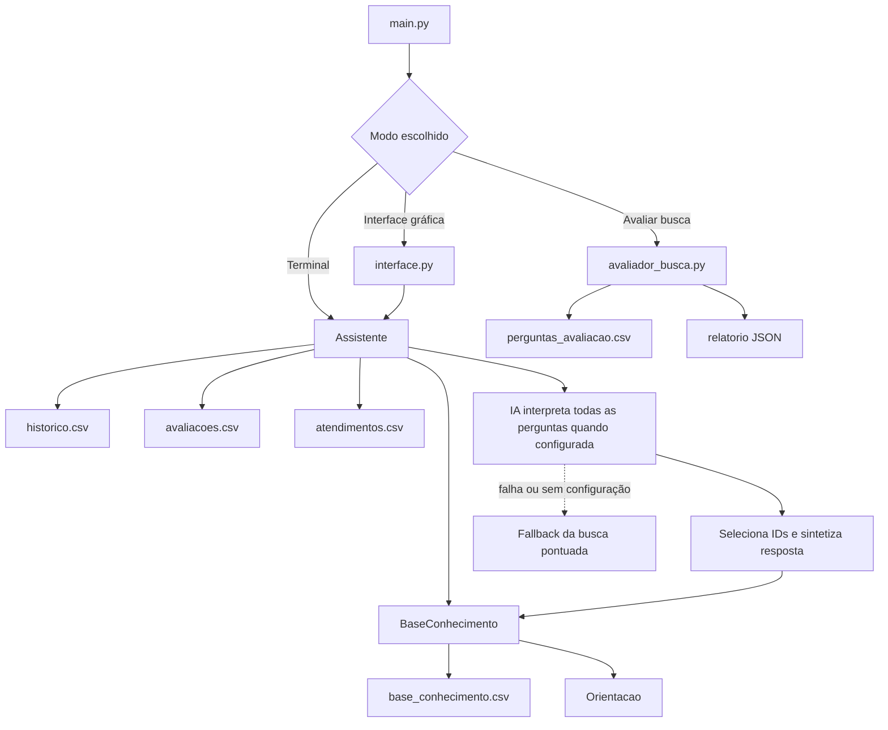

# Decisões técnicas e arquitetura

## 1. Organização por responsabilidade

O projeto separa o modelo, a base de conhecimento, o fluxo de atendimento e a apresentação:

- `Orientacao`: representa um único registro da base e oferece `exibir()`.
- `BaseConhecimento`: carrega e valida o CSV, lista categorias e executa a busca pontuada.
- `Assistente`: coordena as perguntas, protege o histórico, registra avaliações, calcula indicadores e exporta atendimentos.
- `interface.py`: apresenta as funcionalidades em uma aplicação Tkinter.
- `avaliador_busca.py`: executa um benchmark interno de perguntas fixas para comparar a busca entre versões.
- `main.py`: inicializa o projeto e seleciona o modo de uso.

A composição principal é `Assistente` → `BaseConhecimento` → lista de objetos `Orientacao`.

## 2. Busca pontuada obrigatória da FIAP

A busca por pontuação continua implementada e demonstrável, conforme o enunciado. Ela compara pergunta, título e palavras-chave, usando +3 por expressão-chave e +1 por termo relevante do título. A pontuação mede correspondência textual; não é uma probabilidade de a resposta estar juridicamente correta.

A busca local também funciona como fallback quando a IA não está configurada ou fica indisponível. Consultas isoladas como `emprego`, `seguro` e `transporte` possuem tratamentos explícitos na base, sem depender exclusivamente da chamada ao modelo.

## 3. Núcleo conversacional por IA + recuperação (V4.3.0)

Quando Ollama está configurado, `ExpansorConsultaIA.analisar()` é acionado em toda consulta, inclusive quando a busca lexical já encontrou um resultado. O modelo recebe a pergunta e o catálogo completo dos registros locais, interpreta a intenção, classifica o assunto, seleciona IDs de orientações e sintetiza uma resposta em linguagem simples.

A IA pode combinar registros e oferecer recomendações práticas de empregabilidade. IDs e fontes exibidos são validados contra o CSV; o modelo não pode criar IDs nem URLs oficiais. Quando o tema exigir direitos, valores, prazos ou requisitos legais que não estejam sustentados pelos registros, a resposta deve explicitar a limitação e indicar um canal oficial, em vez de inventar uma regra.

A busca pontuada continua sendo executada em paralelo lógico e permanece como fallback. Se a IA falhar, a interface indica que a chamada não foi concluída e apresenta a busca local apenas quando ela encontrar orientação suficiente. O estado de configuração não prova que a API está acessível; `python main.py --testar-ia` faz uma chamada real de diagnóstico.

A IA é chamada somente após bloqueios preventivos de perguntas vazias ou que contenham oito ou mais dígitos ou `@`, conforme o critério do enunciado. Essa verificação não detecta todos os dados pessoais. No modo Cloud, a pergunta e o catálogo local são enviados ao provedor Ollama; o usuário deve evitar inserir nomes, endereços, documentos, contatos, senhas ou qualquer informação identificável.

## 4. Integridade da base

Ao carregar o arquivo, o programa verifica:

- cabeçalho e quantidade de campos;
- preenchimento dos campos obrigatórios;
- IDs duplicados;
- pelo menos três palavras-chave diferentes por orientação;
- fonte com esquema HTTPS e domínio;
- data no formato ISO `AAAA-MM-DD`;
- quantidade mínima de dez orientações e três categorias.

Uma linha inválida é informada e ignorada. Se houver registros válidos, o programa ainda pode ser aberto com a parte íntegra da base. O comando `python main.py --validar-base` permite realizar essa conferência antes da demonstração.

A validação de HTTPS verifica a estrutura do link, não sua disponibilidade nem a atualidade jurídica do conteúdo. A equipe precisa abrir as fontes oficiais e conferir as informações antes da entrega.

## 5. Proteção e persistência

O sistema bloqueia uma pergunta antes da busca e do registro quando ela possui oito ou mais dígitos ou contém `@`, conforme a regra do enunciado.

Os arquivos de histórico são lidos com validação de estrutura e valores. Linhas inválidas são ignoradas com aviso. Se um arquivo apresentar cabeçalho desconhecido, o programa não o sobrescreve automaticamente. Os novos atendimentos continuam contabilizados durante a sessão, mas o sistema informa quando não consegue confirmar sua gravação em disco.

Os arquivos de uso (`historico.csv`, `avaliacoes.csv` e `atendimentos.csv`) estão no `.gitignore`. Isso reduz o risco de publicar perguntas de teste junto com o código.

## 6. Indicadores

Os indicadores são calculados a partir do histórico carregado:

- taxa de respostas encontradas;
- taxa de dúvidas consideradas resolvidas pela pessoa;
- percentual de buscas sem orientação suficiente;
- tempo médio e tentativas médias;
- facilidade média, com quantidade de avaliações;
- dúvidas sem solução;
- orientações mais consultadas.

Não existem valores de demonstração pré-preenchidos. Uma instalação nova começa sem métricas de uso.

## 7. Avaliação reproduzível da busca

O arquivo `data/perguntas_avaliacao.csv` mantém perguntas de referência dentro e fora do tema. O módulo `avaliador_busca.py` compara a orientação esperada com a primeira resposta, observa se a resposta aparece entre as três primeiras e verifica se perguntas fora do escopo são recusadas. O relatório inclui cobertura, acurácia, abstenções e falsos positivos.

Esse conjunto é uma ferramenta interna de regressão e foi escrito pela equipe. Não representa uma amostra estatística de todos os usuários e não substitui o teste obrigatório com pessoas externas.

## 8. Limitações assumidas

Sem o módulo de IA configurado, a busca local é lexical e pode não reconhecer sinônimos, erros de digitação ou perguntas semanticamente equivalentes. Com IA configurada, o modelo interpreta todas as consultas e organiza respostas com base no catálogo local, mas não pesquisa a internet em tempo real nem atualiza a legislação. A cobertura da base é finita, e situações jurídicas individuais ou mudanças posteriores às datas de revisão exigem confirmação oficial. A revisão de conteúdo deve ser um processo separado, documentado e humano.

A proteção de dados é preventiva e simples, exatamente alinhada ao critério do exercício. Ela não substitui mecanismos profissionais de prevenção a vazamentos.

## 9. Fluxo de execução

